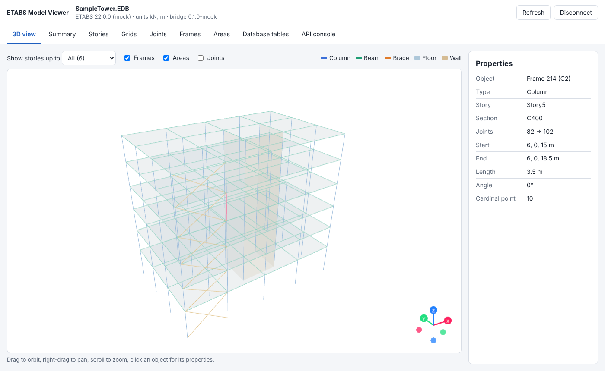

# ETABS Bridge

Connect a running **ETABS** model to web apps, DraftWin and AI assistants.

A small ETABS plugin starts a token-protected **local REST API** inside the exact ETABS window you clicked. A sample
**web app** shows the model in 3D with data tables, an **MCP server** lets Claude and other AI clients query it, and
**DraftWin** (VB.NET) can use the same API or the same C# library directly.

Version **0.6.1**: geometry, sections & materials, a solid (concrete) 3D view, **BOQ & 5D costing** (INR default,
11 currencies), **4D simulation**, **loads** and **analysis/design results**. The full CSI API and every ETABS
database table are also reachable through generic endpoints.

- **Web app (hosted):** <https://etabs-bridge.vercel.app>. It runs in your browser and talks only to the plugin on
  your own PC; model data never passes through Vercel.
- **Plugin download:** the zip from the latest [GitHub Release](https://github.com/ComputerHelp-BIM/etabs-mcp/releases)
  (or the `EtabsBridgePlugin-x.y.z` artifact of any [Plugin workflow run](https://github.com/ComputerHelp-BIM/etabs-mcp/actions/workflows/plugin.yml)).



## What's inside

| Component | Path | Tech |
| --- | --- | --- |
| ETABS plugin + core library | `plugin/` | C# (.NET Framework 4.8 / .NET 8), WinForms, HttpListener |
| Shared TypeScript client and contract schemas | `packages/client` | TypeScript, zod |
| Sample web app | `apps/web` | React 19, Vite 7, Three.js (react-three-fiber) |
| MCP server | `apps/mcp-server` | TypeScript, `@modelcontextprotocol/sdk` |
| Mock bridge (no ETABS needed) | `apps/mock-bridge` | TypeScript, node:http |
| API contract fixtures | `contract/fixtures` | JSON golden files checked by C# **and** TS tests |

Read next: [architecture & decisions](docs/architecture.md) · [REST API](docs/api.md) ·
[install the plugin](docs/install-plugin.md) · [deploy on Vercel](docs/deploy-vercel.md) · [CI/CD](docs/ci-cd.md) ·
[BOQ & 5D](docs/boq-5d.md) · [4D](docs/4d-simulation.md) · [Results](docs/results.md) · [DraftWin (VB.NET)](docs/draftwin-integration.md) · [MCP](docs/mcp.md)

## Quick start without ETABS (any OS)

Requires Node.js 20.19+ (22 LTS recommended) and **npm 11** (`npm install -g npm@11`; npm 10.9 has a workspace bug).

```bash
npm ci
npm run build
npm run mock        # terminal 1: mock bridge on http://localhost:52780, prints ready-made web links
npm run dev:web     # terminal 2 (optional): web app on http://localhost:5173
```

Open one of the `web:` links that `npm run mock` printed: the hosted app (no second terminal needed) or the local dev
server. Each link carries the bridge URL and token.

## With ETABS (Windows)

1. Download `EtabsBridgePlugin-x.y.z.zip` (see above), **unblock** it (right-click → Properties → Unblock), extract.
   Or build it yourself: `cd plugin && dotnet build EtabsBridge.sln -c Release -p:EtabsInstallDir="C:\Program Files\Computers and Structures\ETABS 22"`.
2. In ETABS: **Tools → Add/Show Plugins**, Plugin Name `EtabsBridgePlugin`, path to `EtabsBridgePlugin.dll`
   ([which framework folder](docs/install-plugin.md#which-framework-folder)).
3. Open a model and run **Tools → ETABS Bridge**, then click **Open web app** (opens the hosted app, connected).

Please go through the [first-run checklist](docs/install-plugin.md#first-run-checklist-please-report-results). CI
compiles the plugin against CSI's signed ETABS API and checks every by-name API call against it, but it has not yet
been run inside ETABS.

## API at a glance

```
GET  /api/v1/health                 GET  /api/v1/tables
GET  /api/v1/model                  GET  /api/v1/tables/data?key=...&offset=&limit=
GET  /api/v1/geometry               GET  /api/v1/rpc/describe?path=FrameObj
GET  /api/v1/geometry/{stories|grids|joints|frames|areas}
POST /api/v1/rpc   {"method":"FrameObj.GetSection","args":{"Name":"C1"}}
```

TypeScript:

```ts
import { BridgeClient } from "@etabs-bridge/client";
const etabs = new BridgeClient({ baseUrl: "http://localhost:52780", token });
const { frames, units } = await etabs.frames();
const drifts = await etabs.table("Story Drifts", { limit: 500 });
const section = await etabs.call("FrameObj.GetSection", { Name: frames[0].name });
```

## Development

| Task | Command |
| --- | --- |
| All TS tests / typecheck / build | `npm test` · `npm run typecheck` · `npm run build` |
| C# tests (any OS, .NET 8 SDK) | `dotnet test plugin/tests/EtabsBridge.Core.Tests` |
| Type-check plugin without ETABS | `dotnet build plugin/EtabsBridge.sln -p:UseEtabsStub=true` (**not deployable**) |
| Build the real plugin without ETABS | `scripts/fetch-etabs-api.sh` then `dotnet build plugin/src/EtabsBridgePlugin -c Release -p:EtabsInstallDir=$PWD/.etabs-api` |
| Check by-name API calls against the real API | `scripts/check-etabs-api.sh` |
| Regenerate contract fixtures after an intentional change | `UPDATE_FIXTURES=1 dotnet test plugin/tests/EtabsBridge.Core.Tests` |
| Version consistency | `npm run check-versions` |

Test coverage: 203 C# tests (JSON, geometry rules, late-bound sections/loads/results, RPC policy, HTTP security,
origin matching, real sockets, discovery, settings, dispatcher, contract fixtures) and 143 TypeScript tests (client,
quantities/BOQ/costing, schedule, loads takedown, result helpers, registry, mock bridge, MCP tools over an in-memory
transport, 3D scene and solid extrusion geometry, colour binding, charts, currency formatting).

## Versioning

[Semantic versioning](https://semver.org): `MAJOR.MINOR.PATCH` in `/VERSION`, mirrored into every package and
`Directory.Build.props` (`npm run check-versions` enforces it in CI). Breaking API changes bump MAJOR and the URL
(`/api/v2`); new fields or endpoints bump MINOR; fixes bump PATCH. See [CHANGELOG](CHANGELOG.md).

## Roadmap (one step at a time)

| Version | Step |
| --- | --- |
| 0.1.0 | Geometry: stories, grids, joints, frames, areas; generic tables + RPC; web app; MCP |
| 0.2.0 | Sections & materials; solid concrete 3D view; colour by type/material/section/story; Vercel deployment |
| 0.3.0 | BOQ (concrete, formwork, rebar, steel) and 5D costing with editable rates; CSV/JSON exchange |
| 0.4.0 | 4D simulation: story-by-story schedule, playback in 3D, Gantt, planned-cost S-curve |
| 0.5.0 | Loads: patterns, cases, combinations, assigned loads, gravity takedown |
| 0.6.0 | Results: reactions, drifts, displacements (deformed shape), frame forces, concrete design → BOQ rebar |
| **0.6.1** | Hosted web app (Vercel), plugin CI/CD with GitHub Releases, real-API checks, currency picker |
| next | Field-test fixes from real ETABS; write workflows (opt-in, guarded); shared project storage (team rates/schedules) if needed |
